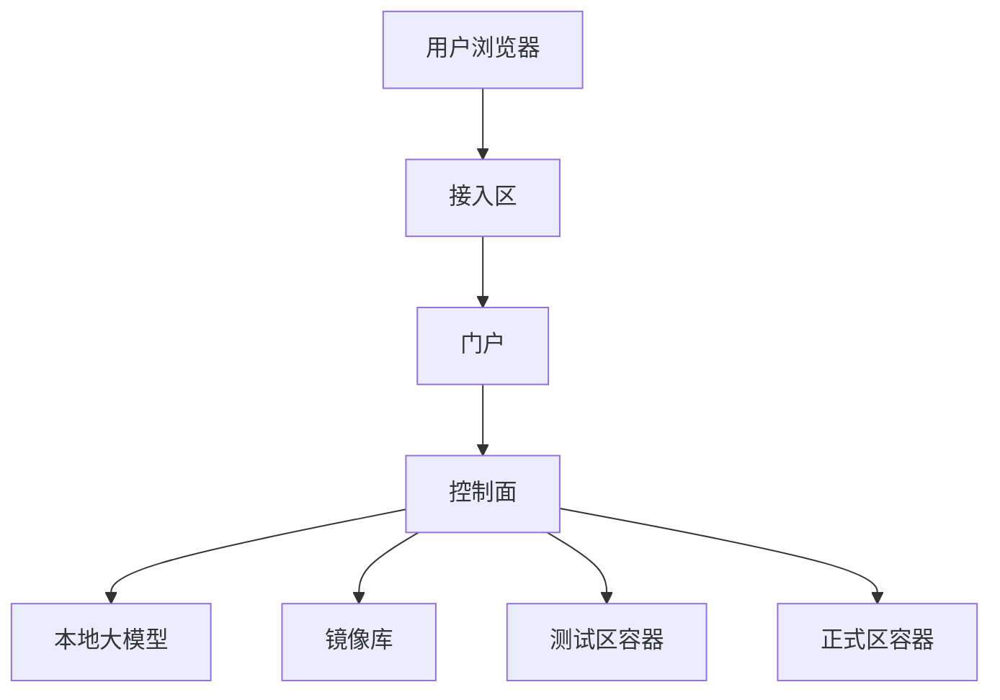

# 企业应用平台总体计划

| 项 | 值 |
|---|---|
| 文档时间 | 2026-11-06 10:21:13 +0800 |
| 进度时间 | 2026-11-11 17:42:46 +0800 |
| 阶段 | 需求已确认。第 1、2、3、4 项已完成并提交。第 5 到第 8 项尚未开始 |
| 行为细则 | `docs/superpowers/specs/2026-11-04-enterprise-harness-platform-design.md` |
| 已暂停的实施计划 | `docs/superpowers/plans/2026-11-05-system-zone-portal-accounts.md` |

需求人员直接提出需求。平台按软件工程知识生成方案和设计，编译成项目自己的服务并在测试区验证，确认后再发布到正式区。系统运行、测试、正式分三套服务器。已知故障由运维智能体按固定动作处理。需要改业务代码时，回到方案确认、在线测试和发布确认。

## 1. 方案

### 1.1 要解决的问题

企业内部业务变更频繁。过去要先写需求说明书，再由开发用专业工具实现，最后交给运维或 DevOps 发布。改成对话式生成之后，仍然需要专人监督开发和部署。本平台把方案、设计、开发、测试、发布和日常运维收成一条可确认的链路，需求人员在门户里完成确认。

### 1.2 使用者

- **需求人员**：创建项目、用会话修改草稿、确认方案、查看测试、确认发布。可以由项目管理员把会话、授权和在线测试单独授出。
- **业务用户**：只使用已发布菜单，处理列表、表单和待办。
- **平台管理员**：管理接入后的系统配置、插件配置、模型配置、节点分区和镜像库，并指定项目管理员。

### 1.3 一次变更

1. 需求进入该用户、该项目的会话。工具只改草稿。
2. 项目管理员确认方案。
3. 系统生成设计，编译项目模块，构建镜像，生成测试案例。
4. 测试只在测试区运行。黑盒走界面，白盒走测试容器入口。
5. 发布确认页展示设计摘要、镜像版本、测试结果、容器组和正式区目标节点。当前候选没有全部通过时，不能确认发布。
6. 确认后，正式区节点更新正式容器。全部目标节点健康后，该版本成为已发布版本。
7. 正式区持续上报。已知故障自动处理。业务代码问题打开变更草稿，重新走方案确认、测试和发布确认。

### 1.4 第一版边界

第一版交付门户、账号、项目会话与授权、生成发布、在线测试、OA 领域包和自动运维。OA 第一版包含组织、请假审批和公告，不包含考勤设备、薪资、合同、印章、公文和固定资产。

第一版不交付企业微信登录、Kubernetes、App 全套界面、微信小程序全套界面、本机命令行代理，以及 WMS、MES、TMS、APS 的具体菜单和流程。App 与小程序以后可以复用同一套菜单、列表、表单和待办的数据结构，不在第一版另做界面。

## 2. 架构设计

平台自研。DeepSeek Harness 只作为插件、会话、工具和提示词装配的参照，运行时不依赖它的代码和进程。

### 2.1 逻辑构件

| 构件 | 职责 | 所在分区 |
|---|---|---|
| 门户 | 登录、导航、草稿预览、确认、通知、已发布页面入口 | 系统运行区 |
| 控制面 | 账号、授权、会话、方案、设计、调度、测试编排、审计 | 系统运行区 |
| 需求会话 | 调用本地模型，只通过固定工具修改草稿 | 系统运行区 |
| 生成器 | 把已确认方案编译成项目模块、镜像和测试案例 | 系统运行区 |
| 私有镜像库 | 保存不可变镜像。系统运行区推送，测试区和正式区只拉取 | 系统运行区 |
| 本地大模型 | 按模型配置提供 OpenAI Chat Completions 兼容接口，供需求会话和运维智能体调用 | 系统运行区 |
| 测试编排 | 在测试区启动候选容器，执行黑盒和白盒，保存记录 | 系统运行区发起，容器在测试区 |
| 调度器 | 保存正式区期望状态。发布确认和运维处置都通过它 | 系统运行区 |
| 运维智能体 | 读取信号，执行固定处置，或打开变更草稿 | 系统运行区 |
| 节点代理 | 拉取镜像，操作本机 Docker，上报心跳、指标和日志 | 测试区或正式区，一台服务器只属一区 |
| 项目容器 | 运行一个容器组的项目模块。正式容器连接正式库，测试容器连接测试库 | 与节点同一区 |
| 系统库 | 账号、草稿、审计、系统配置 | 系统运行区 |
| 项目正式库 | 已发布项目的业务数据 | 正式区 |
| 项目测试库 | 每次测试前重建的数据 | 测试区 |

一个项目是一个逻辑微服务，也是授权里的应用程序。默认独占一个容器。用户可以把多个项目打进同一个容器组镜像，由一个进程按项目编码分发。各项目仍使用自己的数据库。

### 2.2 直接联系

用户浏览器和微信回调只进入接入区。接入区只把门户和回调转到控制面。需求会话连接本地大模型，不连接正式容器。生成器连接镜像库。测试编排连接测试区容器，黑盒时让门户内容区指向测试容器。调度器连接正式区节点代理。节点代理主动连接控制面，并只从镜像库拉取。运维智能体连接调度器和本地大模型，不直接操作 Docker。正式容器只连接正式库，测试容器只连接测试库。

### 2.3 生成物

方案确认前，会话保存草稿：菜单、数据、流程、角色、授权、测试案例和受控扩展边界。确认后生成设计。同一次设计重复编译，源码相同，源码不含编译时间、随机数和本机路径。标准能力编译成菜单、页面、数据和流程。设计里标出的复杂逻辑才编译成受控扩展。OA 第一版没有受控扩展。

## 3. 安全设计

分区之间默认拒绝。下面是允许穿过边界的路径。

| 起点 | 终点 | 允许的内容 |
|---|---|---|
| 互联网 | 接入区 | TCP 443。用户访问和微信回调 |
| 接入区 | 系统运行区 | 门户页面和控制面回调 |
| 系统运行区 | 测试区 | 项目接口 443，以及测试库的建库连接 |
| 系统运行区 | 正式区 | 项目接口 443，以及正式库的建库连接 |
| 测试区或正式区节点 | 控制面 | 节点主动发起的 443，双向证书 |
| 测试区或正式区节点 | 镜像库 | 只拉取 |
| 容器 | 本区项目库 | 启动时注入的业务连接 |
| 运维 VPN | 堡垒机，再到系统运行区 | 管理端口 |

正式区与测试区之间没有路由。一个节点不能同时属于两个区。系统运行服务器不加入测试节点池或正式节点池。Docker 套接字只在节点本机。本地大模型只接受系统运行区调用，不连接数据库和节点。

身份和密钥：

- 平台用户是唯一登录身份。密码用 Argon2id 保存，参数放在系统配置，安装默认内存 19456 KiB、迭代 2 次、并行度 1。
- 登录 Cookie 为 HttpOnly、SameSite=Lax。门户使用 HTTPS 时标记 Secure。
- 初始管理员密码只在安装输出里出现一次，不写入文件。
- 微信密钥只在系统运行区。未配置时扫码入口不显示，并说明原因。账号密码登录保持可用。
- 镜像不包含数据库地址、密钥、模型地址和节点地址。
- 需求会话的工具必须落在调用人有权的项目上。越权调用被拒绝并说明原因。
- 管理员之间看不到对方的对话。同一项目的草稿共享。
- 业务导航只读已发布版本。草稿预览只给有项目管理权限的人。
- 发布确认前，正式容器不变。测试失败不修改正式容器。
- 更换已发布版本、回退、超出节点池扩容、删除数据和修改权限需要确认。
- 每次自动处置和确认后的处置写入审计，时间精确到秒。

模型不能临时拼出任意命令，不能直接改正式容器里的代码，也不能跳过方案确认和发布确认。

## 4. UI/UX 设计

第一版只设计门户。宽度按 1280 像素及以上的工作台使用。窄屏只保证登录页和已发布列表可以阅读，不把需求会话、测试和发布压缩进手机布局。

### 4.1 原则

- 需求人员用会话修改草稿，用页面确认方案、测试和发布。
- 草稿和已发布在界面上同时可见，状态文字分别是「草稿」和「已发布」。
- 一个主按钮只做当前步骤的前进动作。发布、回退、删除使用单独确认。
- 失败时停在当前页，说明原因，并给出可重试或返回草稿的动作。
- 可交互元素带稳定标识，格式为 `{项目编码}/{菜单编码}/{字段或动作编码}`。登录和平台页面使用 `platform/{页面}/{元素}`。

### 4.2 布局

登录前只有登录页和注册页，页面居中，宽度 420 像素。

登录后分成三块：

- 左侧宽 240 像素。上方是平台标题，下方是导航。业务菜单按授权显示。系统配置、插件配置、模型配置只出现在平台管理员的导航里。
- 顶部高 56 像素，靠右排列当前用户、语言和「配置」。
- 其余区域是内容区。内容区内部不再做第二套导航。

项目设计页把内容区再分成左右两栏。左栏是草稿的菜单树和页面预览，右栏宽 400 像素，是当前项目的会话。会话记录只属于当前用户。预览区标明「草稿」。

### 4.3 页面

| 页面 | 使用者 | 内容区要完成的事 |
|---|---|---|
| 登录 | 未登录用户 | 账号、密码、登录。微信已配置时显示扫码；未配置时显示「微信登录未配置」，不显示二维码 |
| 注册 | 未登录用户 | 自行注册开启时收集用户名、显示名和密码。关闭时说明联系管理员 |
| 空工作台 | 已登录且没有授权菜单 | 有建项权限的人看到「创建项目」。其他人看到「联系管理员」 |
| 项目会话 | 需求人员 | 左栏预览草稿，右栏对话。一句话产生的菜单、角色和授权立即出现在左栏 |
| 方案确认 | 项目管理员 | 展示本次草稿相对已发布版本的新增、修改和删除。主按钮是「确认方案」 |
| 测试结果 | 有测试权限的人 | 按案例列出黑盒或白盒、通过或失败、开始时间和失败步骤。可以回放一条记录 |
| 发布确认 | 项目管理员 | 展示设计摘要、镜像版本、测试总结果、容器组、同组项目和正式区节点。测试未全部通过时，主按钮不可用，并列出失败案例 |
| 系统配置 | 平台管理员 | 标题、语言、注册开关、微信三项、两个项目库地址、镜像库地址 |
| 插件配置 | 平台管理员 | 第一版显示入口和启停记录，不预装业务插件 |
| 模型配置 | 平台管理员 | 本地模型地址、模型名和密钥。为空时说明会话和运维智能体不会调用模型 |
| 个人配置 | 当前用户 | 显示名、密码、微信绑定、语言 |
| 运维状态 | 项目管理员看本项目，平台管理员看全部节点 | 健康、最近自动处置、待确认动作 |
| 业务列表 | 业务用户 | 按授权显示查询结果，以及新增、修改、删除 |
| 业务表单 | 业务用户 | 按设计字段提交 |
| 待办 | 业务用户 | 同意、驳回当前审批任务 |

### 4.4 关键路径

创建项目：空工作台或会话里的一句话提交名称。系统生成可修改的编码。默认单独容器组。创建者成为项目管理员，并进入项目会话页。

确认方案：用户在右栏说完需求后，左栏已经显示草稿。打开方案确认页核对增量。确认后内容区进入「正在生成设计和测试」，正式菜单不变。

发布：测试结果页的总结果为通过后，发布确认页的主按钮才可用。同组还有其他项目时，确认页列出这些项目，并说明本次会更新整个容器组。取消确认后留在该页，正式容器不变。

日常使用：业务用户从左侧打开已发布菜单，内容区显示列表、表单或待办。看不到草稿、会话和发布。

### 4.5 状态

- 加载中：内容区保留标题，数据区显示正在加载，不闪到空白页。
- 无权限：内容区说明没有访问该菜单的权限。
- 请求失败：说明失败原因，提供「重试」。登录失败留在登录页。
- 停用账号：登录页说明账号已停用。
- 模型未配置：项目会话页说明原因，输入框不可发送。已发布页面仍可使用。

界面语言第一版至少提供简体中文。语言列表来自系统配置。OA 模板名称使用简体中文。

## 5. 测试架构设计

测试是发布前的一道门，不是正式区里的巡检。正式区不运行 `runtime.mode=test` 的容器。

### 5.1 分层

| 层 | 验证什么 | 在哪里跑 | 是否调用模型 |
|---|---|---|---|
| 设计案例生成 | 同一设计得到同一组案例 | 系统运行区的生成器 | 不调用。案例由设计编译 |
| 黑盒 | 菜单、表单、流程和角色是否按界面工作 | 测试区。Midscene.js 通过 Playwright 操作门户 | 视觉定位调用模型配置里的多模态模型 |
| 白盒 | 字段校验、流程迁移、接口结果、授权拒绝 | 测试容器内的 Vitest 入口 | 不调用 |
| 回放 | 已有记录能否对当前候选重新执行 | 测试区 | 与原记录相同，不重新请模型决策 |
| 发布门 | 当前候选是否有一次全部通过的记录 | 系统运行区 | 不调用 |

黑盒组件是 Midscene.js，许可 MIT。它通过官方的 Playwright 集成驱动浏览器，Playwright 许可 Apache-2.0。生成的黑盒案例写成 Midscene 步骤：打开页面、输入、断言。页面仍带稳定标识。Midscene 先按稳定标识操作；标识失败时再用它的视觉定位。视觉定位调用系统配置里的模型地址，协议使用 Midscene 默认的 `openai-chat`。模型不能看图时，该步失败并说明原因，不用屏幕坐标点击。Midscene 的 HTML 报告留在测试区，平台把每步结果写入系统库的测试记录。回放重新执行已保存的 Midscene 步骤。

白盒组件是 Vitest，许可 MIT。它不经过浏览器，入口只在测试容器开放。

### 5.2 案例从哪里来

编译设计时生成案例。同一设计重复编译，自动案例相同。用户在会话里追加的案例一直保留，直到用户删除。没有写明输入值时，文本使用字段名加「示例」，数字使用 1，布尔使用真，日期使用 `2000-01-01`，日期时间使用 `2000-01-01T00:00:00`。引用字段写明依赖的前序步骤。

OA 第一版至少生成：员工提交请假、部门负责人审批、人事备案、员工不能删除人事菜单、请假单缺少必填字段被拒绝。前三项是黑盒，后两项是白盒。

### 5.3 环境和记录

测试容器副本数是 1，只用测试区节点池。节点池为空时测试不开始，不改到正式节点。每次运行前重建测试库。运行结束、失败或超过 `test.runTimeoutSeconds` 后删除测试容器。默认总时限 900 秒，单步 30 秒。案例和记录保留在系统库。

每步记录包含开始时间、案例编码、方法、候选镜像摘要、定位方式、输入、期望、实际结果、通过或失败。时间精确到秒。回放对当前候选重新执行，并写成一条新记录，注明原记录和原镜像摘要。

`test.requirePassBeforePublish` 默认为真。为真时，没有一次全部通过的记录就不能确认发布。

测试失败不打开运维处置。需要改设计时，走变更草稿。

## 6. 运维架构设计

运维只观察和处置已发布版本。它不注入领域包，不修改方案和设计，不读取测试库。

### 6.1 信号

正式区节点上的 OpenTelemetry Collector 采集心跳、CPU、内存、磁盘、容器状态、运行镜像摘要是否等于期望摘要、项目错误率、延迟、正式库连通性和结构化日志。指标进入 Prometheus，日志进入 VictoriaLogs。两者都在系统运行区，许可都是 Apache-2.0。日志带项目编码、版本和追踪标识。

系统运行区保存这些信号。判定阈值放在系统配置，安装默认值为：心跳超时 30 秒，600 秒内最多重启 3 次，错误率 0.05，统计窗口 300 秒，窗口内至少 20 个请求才按错误率打开变更草稿。

### 6.2 智能体和处置

调查组件是 HolmesGPT，许可 Apache-2.0。它用只读工具查询 Prometheus 和 VictoriaLogs，模型使用系统配置里的地址，并且必须支持工具调用。HolmesGPT 不执行重启、重新调度和回退。这些动作仍由平台调度器按下面的固定规则执行。提示词只有运维角色、当前状态快照、已发布版本和固定工具。

自动处置只有四类：进程退出后的限额内重启，镜像拉取暂时失败后的重试，数据库连接中断后的重启，节点心跳丢失后在同一正式节点池里重新调度且副本数不变。公用容器组只有整个进程不可用时才整组重启，并通知组内所有项目。

错误率达到阈值、受控扩展抛错、业务规则不符合预期时，打开变更草稿并附上日志和指标。不修改运行中的代码。

更换已发布版本、回退、把目标扩大到当前节点池之外、删除数据、修改权限，先在门户生成待确认动作。

### 6.3 可见性和审计

平台管理员查看全部节点。项目管理员只查看本项目的状态、处置记录和待确认动作。通知只出现在门户内。审计字段包括项目或节点、信号、动作、结果、操作者和精确到秒的时间。自动动作的操作者是运维智能体。

节点池里没有其他健康节点时，保持期望状态并通知项目管理员，不把容器调度到测试区，也不扩大节点池。

## 7. 各阶段开源组件

每个阶段选用一个负责该阶段主要工作的开源组件。平台保留确认、授权、分区和发布门，不把需求人员交给这些组件的命令行。

| 阶段 | 开源组件 | 许可 | 负责的工作 | 平台仍自己实现 |
|---|---|---|---|---|
| 方案 | OpenSpec | MIT | 一次变更只记录新增、修改、删除。控制面按这个结构保存方案和设计 | 会话、固定工具、方案确认和发布确认 |
| 运行 | PostgreSQL 16、Docker Engine、Distribution `registry:2` | PostgreSQL License、Apache-2.0、Apache-2.0 | 系统库和项目库、容器、私有镜像库 | 生成器、节点代理、调度器 |
| 安全接入 | Caddy 2 | Apache-2.0 | 接入区 TLS 和反向代理，只发布 443 | 分区之间默认拒绝、节点双向证书、审计 |
| 界面 | React、Ant Design、Vite | MIT、MIT、MIT | 门户的导航、表格、表单、确认框，以及开发时热加载 | 草稿与已发布的区分、右侧会话栏、页面稳定标识 |
| 测试 | Midscene.js、Playwright、Vitest | MIT、Apache-2.0、MIT | Midscene 做黑盒界面操作、视觉定位和步骤报告。Playwright 是它的浏览器驱动。Vitest 做白盒 | 由设计编译案例、测试区隔离、未通过不能发布 |
| 运维 | OpenTelemetry Collector、Prometheus、VictoriaLogs、HolmesGPT | 均为 Apache-2.0 | 采集指标和日志，只读调查故障原因 | 限额内重启、同区重新调度、待确认动作、门户通知 |
| 本地模型 | vLLM | Apache-2.0 | 在系统运行区提供 OpenAI Chat Completions 兼容接口 | 模型地址、模型名和密钥只写在模型配置里 |

Midscene 的模型地址使用 `model.baseUrl`，不在测试代码里写死服务商。vLLM 是安装时的默认推理服务；换成别的兼容接口时，只改模型配置。HolmesGPT 查询不到原因时，平台打开变更草稿，不由 HolmesGPT 修改正式容器。

## 8. 实现顺序

实现原则是先搭骨架，再按阶段补充内容和开源构件。第一份可执行计划是 `docs/superpowers/plans/2026-11-06-platform-skeleton.md`。骨架跑起来之后，再分别写账号、OpenSpec 草稿、生成发布、Midscene 测试、OA 内容、运维组件和 vLLM。`docs/superpowers/plans/2026-11-05-system-zone-portal-accounts.md` 停止使用。

进度核对时间：2026-11-12 10:00:00 +0800。对照本节 8 项清单：第 1 到第 4 项已完成并提交，最新提交是 `750b4ff`，已推送到远程 `origin/platform-skeleton`。第 3、4 项随 `750b4ff` 提交，覆盖设计编译、镜像推送、节点安装脚本与证书材料、节点代理拉取并更新容器、公用容器组重建与通知、发布取消，以及发布确认摘要。在线测试真正执行属于第 5 项。第 5 到第 8 项尚未开始。文档记录的最近一次全量测试是 2026-11-11 17:41:57，21 个文件、45 个测试通过。

| 顺序 | 计划 | 状态 | 核对结果 |
|---|---|---|---|
| 1 | 平台骨架 | ✅ 已完成 | 分支 `platform-skeleton`，骨架提交至 `0ae926a`。后续账号提交也在同一分支 |
| 2 | 账号与系统配置 | ✅ 已完成 | 计划 `docs/superpowers/plans/2026-11-11-accounts-system-config.md`。2026-11-11 09:39:55 全量测试 12 个文件、22 个测试通过。提交 `c67e8d6`。完成安装管理员、密码登录、微信未配置时不显示扫码，以及管理员配置入口 |
| 3 | 方案与会话 | ✅ 已完成 | 计划 `docs/superpowers/plans/2026-11-11-projects-sessions.md`。项目编码、共享草稿、会话隔离、授权并集和未发布菜单已覆盖，并包含在 2026-11-11 17:05:12 的全量测试中。随提交 `750b4ff` 提交。正式发布、编译和项目镜像不在本阶段。其后本地门户补充了工作台布局、语言切换、导航折叠、窄屏和模型未配置提醒，这些也不改变本阶段边界 |
| 4 | 生成与发布 | ✅ 已完成 | 记录 `docs/superpowers/plans/2026-11-11-generate-publish.md`。2026-11-11 17:41:57 全量测试 21 个文件、45 个测试通过。随提交 `750b4ff` 提交。已实现设计编译、镜像推送、节点安装脚本与证书、代理协调、公用容器组重建与通知、发布取消和发布确认摘要。在线测试执行不在本阶段 |
| 5 | 在线测试 | ⬜ 未开始 | 计划尚未编写。Vitest 只用于骨架自身的测试 |
| 6 | OA 内容 | ⬜ 未开始 | 计划尚未编写 |
| 7 | 运维 | ⬜ 未开始 | 计划尚未编写 |
| 8 | 本地模型 | ⬜ 未开始 | 计划尚未编写 |
